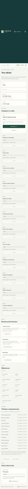
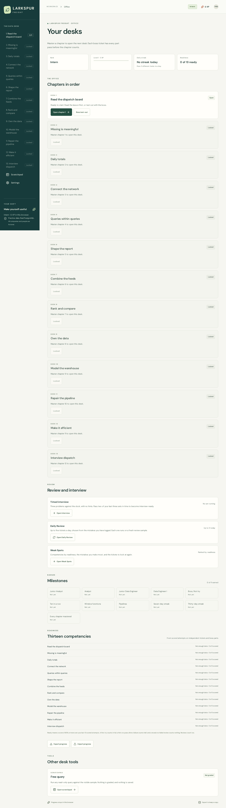
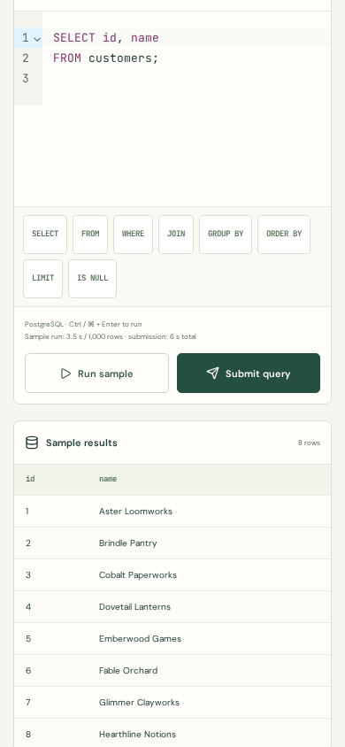
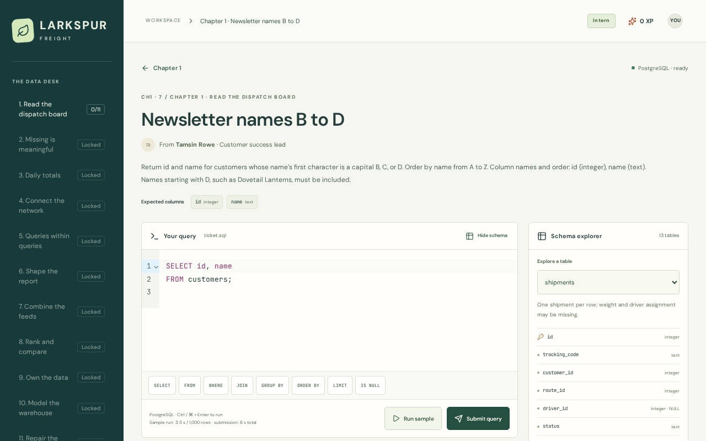

# Larkspur Freight · The Data Desk

A browser-only PostgreSQL practice game. You take tickets from fictional colleagues at a fictional freight company, read a worked example, edit SQL, and check your answer against deterministic datasets. PostgreSQL runs in a WebAssembly worker in your browser. Progress is saved in that browser's localStorage. There is no backend and no account.

| Phone, 390 px | Desktop, 1280 px |
|---|---|
|  |  |
|  |  |

The screenshots come from the production build, taken by `scripts/screenshots.mjs`.

## Status

- Thirteen chapters of curriculum. Each chapter has a lesson with an editable example, guided practice, independent tickets and a boss ticket.
- A game loop with ranks, XP, streaks, badges, mastery and per-competency readiness.
- Spaced review (Daily Review and Weak Spots) and a timed interview.
- An installable, offline-capable build. The SQL engine is cached the first time a SQL screen opens.
- Deployment is written and linted, but **the site is not live yet**. It waits on the account steps in [DEPLOY.md](DEPLOY.md).

## The fiction

Every company, colleague, customer and dataset in the game is invented. Nothing describes a real business or a real person. [docs/name-check.md](docs/name-check.md) records the company-name search, its scope and what it did not settle.

## Architecture

- **Interface.** React 19, Vite, strict TypeScript and Tailwind. CodeMirror 6 loads with the SQL workspace. The office map loads neither the editor nor the engine.
- **Engine.** PGlite, PostgreSQL compiled to WebAssembly, runs in one warm Web Worker. The worker keeps one isolated schema per dataset.
- **Isolation.** Each learner query and each reference query runs inside `BEGIN` … `ROLLBACK`, with a dataset role, a fixed `search_path` and a statement timeout. Nothing a learner runs persists. A main-thread deadline terminates the worker when a query hangs, because the WASM build does not reliably honour the statement timeout for blocking work. Ordinary SQL mistakes roll back without restarting the engine.
- **Statement checks.** libpg-query parses each submission. Every ticket declares which statement kinds it allows. Session and server statements are refused in every ticket.
- **Saves.** Progress is a versioned localStorage save, with tested migrations from earlier versions. A save that is newer than the app, or unreadable, is kept rather than overwritten. Export writes the save to a file.
- **Offline.** A hand-written service worker precaches only the application shell. The engine and lazily loaded code are cached on first use. Each build has its own cache names, and a new version waits for the reader to choose to reload.
- **Security.** One Content-Security-Policy string, in `src/security/csp.ts`, is the source for the preview server and the deployment template. A test fails if the template's copy differs. It allows `'wasm-unsafe-eval'` for the engine and no general `eval`. The app contacts no origin other than its own. Fonts are self-hosted.
- **Hosting (planned, in [DEPLOY.md](DEPLOY.md)).** A private S3 bucket behind CloudFront, read through Origin Access Control. Security headers come from a CloudFront response-headers policy. A CloudFront Function serves the precompressed brotli or gzip file to clients that accept it. A WAF web ACL sits in front of the distribution. GitHub Actions deploys through OIDC, and the deploy role trusts only the `main` branch. A monthly budget is filtered on the project tag.

## How a ticket is graded

1. The learner's query and the reference query run through the same path, on the visible sample and on two hidden edge-case datasets.
2. Results are compared as multisets, unless the ticket requires an order. Structural requirements, such as a required join or window function, are checked by parsing the SQL.
3. Write tickets are graded by database state. The learner's statements run, then trusted catalog and table checks, then constraint tests. All of it runs in one transaction that rolls back. The reference must pass every test.
4. Each graded item has deliberately wrong variants. Each variant is tagged with a mistake from the taxonomy, and a submission that returns exactly a variant's rows gets that mistake's explanation.

Hints come in three tiers and cost XP without blocking anything. Solutions unlock on request or after three failures, at reduced XP.

## How the content is checked

The content rules are enforced by tests as well as by review:

- **Blind solving.** A separate agent solves each graded challenge from its instructions, without the reference. `tests/blind-compare.test.ts` requires its answers to agree with the reference on every dataset.
- **Coverage.** Every rule a ticket states is declared, and each declared rule has a wrong variant that at least two datasets catch.
- **Quotes.** Every quote must appear verbatim on its cited page. `scripts/verify-quotes.mjs` checks this. A weekly workflow runs the check against the live pages and opens one issue when a quote is missing.
- **Production scan.** `scripts/check-production.mjs` fails the build if development-only markers appear in the shipped JavaScript, or if the engine is precached.

The working rules and the roadmap are in [CLAUDE.md](CLAUDE.md). The plan is in [docs/implementation-plan.md](docs/implementation-plan.md).

## Run it

Use Node 24, as CI does. Node 22.12 or newer also works.

```sh
npm ci
npm run dev
```

```sh
npm run check              # lint, unit tests, production build, production scan
npm run check:quotes       # checks each quote against its live page (reads public pages)
npm run test:e2e:chromium  # browser journeys at 390 and 1280 px, with axe
```

Install the browsers once:

```sh
PLAYWRIGHT_BROWSERS_PATH=0 npx playwright install --with-deps chromium webkit
```

Do not run browser commands at the same time: the production previews use port 4173. The cross-browser workflow runs both browser projects on every push to `main`.

## Measurements

Lighthouse, mobile preset, median of three runs on the production preview: performance 98, accessibility 100, best practices 100, SEO 91 ([docs/lighthouse/summary.json](docs/lighthouse/summary.json)). These were measured locally, not against the live site.

## Progress and privacy

Progress belongs to one browser. There is no sync between devices. Export and import move a save file by hand.

Hidden datasets are not encrypted. This is a client-only learning game, so a determined reader can inspect the bundled content.

## Sources and attribution

The lessons cite and quote the pages below. Each quote is checked against the page text.

### PostgreSQL 18 documentation (36 pages)

| Page | URL |
|---|---|
| 8.5. Date/Time Types | https://www.postgresql.org/docs/18/datatype-datetime.html |
| 5.5. Constraints | https://www.postgresql.org/docs/18/ddl-constraints.html |
| 5.3. Identity Columns | https://www.postgresql.org/docs/18/ddl-identity-columns.html |
| 9.21. Aggregate Functions | https://www.postgresql.org/docs/18/functions-aggregate.html |
| 9.2. Comparison Functions and Operators | https://www.postgresql.org/docs/18/functions-comparison.html |
| 9.18. Conditional Expressions | https://www.postgresql.org/docs/18/functions-conditional.html |
| 9.9. Date/Time Functions and Operators | https://www.postgresql.org/docs/18/functions-datetime.html |
| 9.1. Logical Operators | https://www.postgresql.org/docs/18/functions-logical.html |
| 9.7. Pattern Matching | https://www.postgresql.org/docs/18/functions-matching.html |
| 9.3. Mathematical Functions and Operators | https://www.postgresql.org/docs/18/functions-math.html |
| 9.4. String Functions and Operators | https://www.postgresql.org/docs/18/functions-string.html |
| 9.24. Subquery Expressions | https://www.postgresql.org/docs/18/functions-subquery.html |
| 9.22. Window Functions | https://www.postgresql.org/docs/18/functions-window.html |
| 11.1. Introduction | https://www.postgresql.org/docs/18/indexes-intro.html |
| 11.10. Operator Classes and Operator Families | https://www.postgresql.org/docs/18/indexes-opclass.html |
| 7.6. LIMIT and OFFSET | https://www.postgresql.org/docs/18/queries-limit.html |
| 7.5. Sorting Rows (ORDER BY) | https://www.postgresql.org/docs/18/queries-order.html |
| 7.3. Select Lists | https://www.postgresql.org/docs/18/queries-select-lists.html |
| 7.2. Table Expressions | https://www.postgresql.org/docs/18/queries-table-expressions.html |
| 7.4. Combining Queries (UNION, INTERSECT, EXCEPT) | https://www.postgresql.org/docs/18/queries-union.html |
| 7.8. WITH Queries (Common Table Expressions) | https://www.postgresql.org/docs/18/queries-with.html |
| COMMIT | https://www.postgresql.org/docs/18/sql-commit.html |
| CREATE INDEX | https://www.postgresql.org/docs/18/sql-createindex.html |
| CREATE VIEW | https://www.postgresql.org/docs/18/sql-createview.html |
| DELETE | https://www.postgresql.org/docs/18/sql-delete.html |
| EXPLAIN | https://www.postgresql.org/docs/18/sql-explain.html |
| 4.2. Value Expressions | https://www.postgresql.org/docs/18/sql-expressions.html |
| INSERT | https://www.postgresql.org/docs/18/sql-insert.html |
| MERGE | https://www.postgresql.org/docs/18/sql-merge.html |
| ROLLBACK | https://www.postgresql.org/docs/18/sql-rollback.html |
| SELECT | https://www.postgresql.org/docs/18/sql-select.html |
| UPDATE | https://www.postgresql.org/docs/18/sql-update.html |
| 2.7. Aggregate Functions | https://www.postgresql.org/docs/18/tutorial-agg.html |
| 2.5. Querying a Table | https://www.postgresql.org/docs/18/tutorial-select.html |
| 3.4. Transactions | https://www.postgresql.org/docs/18/tutorial-transactions.html |
| 3.5. Window Functions | https://www.postgresql.org/docs/18/tutorial-window.html |

### Microsoft Learn, SQL Server Transact-SQL (3 pages)

These pages are cited for dialect differences from PostgreSQL.

| Page | URL |
|---|---|
| CREATE TABLE (Transact-SQL) | https://learn.microsoft.com/en-us/sql/t-sql/statements/create-table-transact-sql |
| MERGE (Transact-SQL) | https://learn.microsoft.com/en-us/sql/t-sql/statements/merge-transact-sql |
| SET IDENTITY_INSERT (Transact-SQL) | https://learn.microsoft.com/en-us/sql/t-sql/statements/set-identity-insert-transact-sql |

No Apache Spark or Databricks pages are quoted yet. Those dialect notes will come later, as content that needs review.

Fonts are DM Sans and JetBrains Mono, self-hosted under the SIL Open Font License. Their licence texts ship in `public/licenses`.

## More evidence

- [Original Step 1 prompt](docs/step-1-prompt.md)
- [Curriculum, schema and challenge design](docs/content-design.md)
- [Independent blind content review](docs/content-review.md)
- [Warm execution, isolation, memory and timings](docs/warm-engine-findings.md)
- [Bundle analysis and real compression](docs/bundle-findings.md)
- [Engine experiments](docs/engine-spike.md)
- [Fictional company name check](docs/name-check.md)
- [Deployment](DEPLOY.md)
- [Working rules and roadmap](CLAUDE.md)
