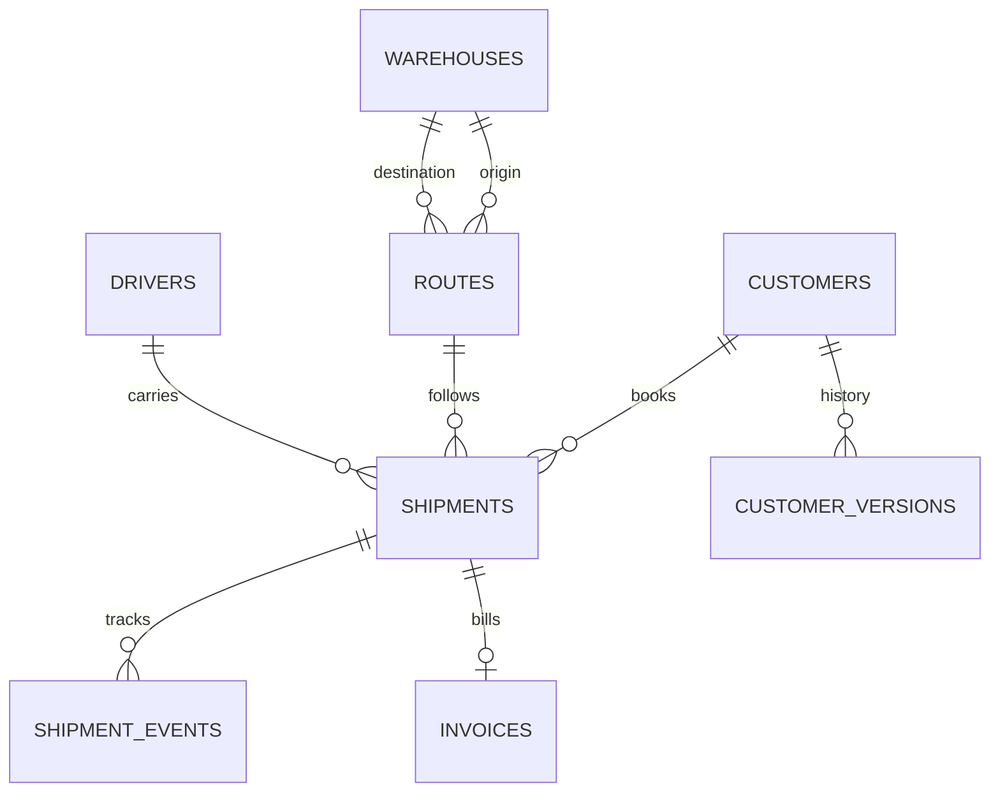

# Step 1 implementation plan

Status: this original implementation plan has been carried into code and is in
final validation. Current evidence lives in the README and findings documents.
The user removed WebKit as a build prerequisite; local WebKit now runs.
This plan is retained for design context, not as a current completion audit.
The original requirements are preserved in [step-1-prompt.md](step-1-prompt.md).

## Gate 0: choose the engine with evidence

Test the current PGlite release in a real browser worker before implementing
the game. Run DDL, inserts, a join, a CTE, a window function, and upserts.
Record asset sizes, startup timings, WASM memory, and UI heartbeat observations.
Use production assets and a CSP allowing `wasm-unsafe-eval` without general
`unsafe-eval`. Repeat in Chromium and Playwright WebKit at phone width.

PGlite is the provisional choice because it runs PostgreSQL rather than a
different SQL dialect. Chromium success alone does not satisfy the gate.
Only evaluate DuckDB-WASM if PGlite fails a supported browser capability test;
a blocked browser download is not evidence that PGlite is incompatible.
If neither engine works in WebKit, stop and report that finding.

The initial name was provisional. A later check found Juniper Freight Lines Inc,
a registered freight carrier, so the company is now Larkspur Freight. See
`docs/name-check.md` for the search evidence and its limits.

## Gate 1: foundations

After the engine gate passes, add React, strict TypeScript, Tailwind, and
CodeMirror 6. Use feature-level lazy imports and a separately loaded engine.
No backend, remote fonts, or runtime external origins. Add ESLint enforcement
of block-bodied React effects before adding effects.

### Curriculum as typed data

Each chapter stores an ID, prerequisites, competency IDs, explicit learning
objectives, planned counts, and official documentation references. Each chapter
will follow lesson/example → guided practice → independent tickets → boss.
The boss pass, not XP, unlocks descendants. The three Step 1 samples are a
development showcase; the rank/skill-tree game loop belongs to Step 4.

| Chapter | Prerequisites | Competency | Planned objectives | Planned tickets (guided / independent / boss) |
| --- | --- | --- | --- | --- |
| 1. Read the dispatch board | none | 1 | SELECT, FROM, aliases, WHERE, comparisons, AND/OR/NOT, ORDER BY, LIMIT, DISTINCT, LIKE, IN, BETWEEN | 5 / 5 / 1 |
| 2. Missing is meaningful | 1 | 2 | IS NULL, COALESCE, three-valued logic, NULL in aggregates and joins; join examples preview chapter 4 | 3 / 4 / 1 |
| 3. Daily totals | 2 | 3 | COUNT/SUM/AVG/MIN/MAX, GROUP BY, HAVING, COUNT(*) vs COUNT(column) | 3 / 5 / 1 |
| 4. Connect the network | 3 | 4 | Inner/left/right/full/self joins, multi-table joins, LEFT JOIN anti-join, NOT EXISTS anti-join, cardinality and row explosion | 4 / 7 / 1 |
| 5. Queries within queries | 4 | 5 | Scalar/IN/EXISTS/correlated subqueries, WITH, refactoring nested SQL | 3 / 5 / 1 |
| 6. Shape the report | 5 | 6 | CASE, strings, date/time functions, casts | 3 / 5 / 1 |
| 7. Combine the feeds | 6 | 7 | UNION vs UNION ALL, INTERSECT, EXCEPT | 2 / 4 / 1 |
| 8. Rank and compare | 7 | 8 | ROW_NUMBER/RANK/DENSE_RANK, LAG/LEAD, running totals, moving-average frames, top-N per group, deterministic deduplication | 4 / 7 / 1 |
| 9. Own the data | 8 | 9 | Types, CREATE TABLE, PK/FK, NOT NULL/UNIQUE/CHECK, INSERT/UPDATE/DELETE, transactions | 4 / 6 / 1 |
| 10. Model the warehouse | 9 | 10 | Normalization, facts/dimensions, star schema, surrogate keys | 2 / 4 / 1 |
| 11. Repair the pipeline | 10 | 11 | ON CONFLICT/MERGE, incremental loads, SCD2, duplicate/orphan/null/range checks, views | 3 / 7 / 1 |
| 12. Make it efficient | 11 | 12 | Indexes, beginner EXPLAIN, common performance anti-patterns | 2 / 4 / 1 |
| 13. Interview dispatch | 12 | 13 | Timed multi-part screens spanning the prior competencies | 1 / 4 / 1 |

Tests must validate prerequisites exist, unique IDs, acyclicity, reachability
from chapter 1, and coverage of all 13 competencies. Every objective above
must map to data, rather than relying only on a broad competency label.
Each chapter's later dialect notes cite PostgreSQL, Microsoft Learn, and
Spark/Databricks official docs. This table is not the tested curriculum data yet.

### Proposed eight-table practice schema

Use integer surrogate keys, synthetic names and UTC timestamps. Model warehouse
origin/destination as two foreign keys. Include nullable assignments, delivered
and cancelled shipments, repeated prices/weights, tied timestamps, and boundary
dates. Customer history supports later SCD2 tickets. The production practice
schema is planned; the engine experiment uses two tiny, separate probe tables.

Use an explicitly specified seeded PRNG, stable row ordering, and a fixed base
date; never use wall-clock time or Math.random in seed generation. Generate
hundreds of shipments and thousands at most of events. Prove same-seed byte
equality, different-seed variation, referential integrity, and expected edge
cases. Challenge-specific dataset variants may be smaller for fast grading.

## Gate 2: grader and state

- Parse PostgreSQL SQL to ASTs. Choose and verify a parser that preserves CTE,
  window, and top-level statement structure. Reject multiple statements and
  disallowed statement types for read-only tickets. Never match keywords with
  regex to award structural credit.
- Run each learner/reference pair against equivalent fresh databases for each
  dataset: one public fixture plus at least two hidden variants. Never run the
  reference after learner mutations in the same database.
- Preserve ordered rows when the ticket demands order; otherwise compare
  multisets with multiplicities. State column name, order, and Postgres type
  rules explicitly. Normalize typed values, NULL, timestamps and numerics
  without conflating SQL NULL and text or losing bigint precision.
- Bound query time by both engine statement timeout and main-thread worker
  termination. Hard-stop runaway workers and recreate them for the next run.
  Enforce a result row cap before sending data to the main thread. Test
  oversized results and intentionally expensive SQL; the spike's 30-second
  startup watchdog is not the future grader's query limit.
- Return small diffs of missing/extra/wrong rows and the failed dataset label,
  never complete hidden fixtures. Client-side fixtures are inspectable by a
  determined user; hidden means withheld from normal UI, not secret storage.
- Test duplicate rows, NULLs, ties, empty results, metadata mismatch, and
  precision. Run every reference on all variants and demonstrate an
  intentionally wrong solution failing at least one variant.
- Use localStorage schema version 1 with explicit migrations from an absent
  save, validated deserialization, corrupt-save recovery, and forward-version
  protection. Save draft SQL, attempts, hint tier, solution reveal, and passes.
  No game-loop features from later steps.

## Gate 3: three playable tickets

1. Beginner write-query: list eligible shipments with explicit output columns,
   filter conditions, and deterministic order. Edge cases: boundary weights,
   NULL assignments, empty eligibility, and ties broken by ID.
2. Fix-the-bug: repair an aggregate that mishandles unbilled shipments or NULLs.
   Edge cases: no matching invoice, repeated amounts, and duplicate join rows.
3. Window ticket: latest event per shipment using ROW_NUMBER with a defined
   tie-breaker. Edge cases: same timestamps, shipments with no events, multiple
   events and out-of-order inserts. Require a parsed window-function AST node.

Ticket text, reference SQL, worked lesson queries, tiered hints and solutions
will be authored only after the engine gate. A separate reviewer solves each
ticket without seeing reference SQL, then checks explanations against official
docs and reports ambiguities. That review has not happened yet.

Minimal UI: a freight dispatch desk with ticket inbox, SQL workspace, result
feedback, schema explorer and tappable keyword bar. Provide SQL highlighting
and schema-aware completion, a runnable/editable example, guided practice for
the early sample, hint costs, solution reveal on request or after three failed
attempts, and reduced rewards after reveal. Never make XP an unlock gate.

Commit Playwright specs with axe scans at 390px and desktop. Exercise the main
journey using taps, ensure no page-level horizontal overflow, and keep wide
result tables within a separately scrollable region. Also test keyboard use,
timeout recovery and progress reload. The engine lab is not this first game UI.

## Gate 4: audit and preservation

Run typecheck/build, lint, unit/integration tests, production debug-hook scan,
Chromium/WebKit journey tests and axe. Record passes, failures and blocked checks
separately. Produce the requested engine/curriculum/schema/grader/challenge audit.
Commit with the requested noreply identity; push main and verify exact equality
of HEAD, origin/main, and the remote main SHA. Stop for Step 1 review.
Do not start Step 2 without explicit approval.
